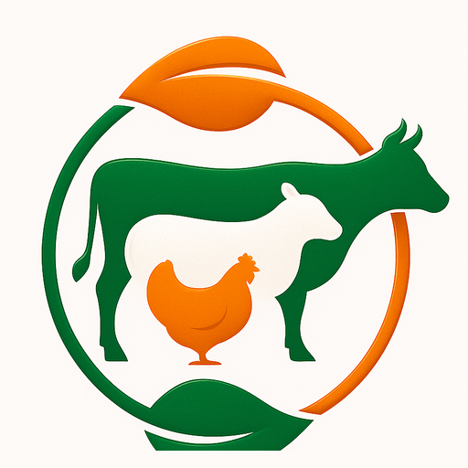
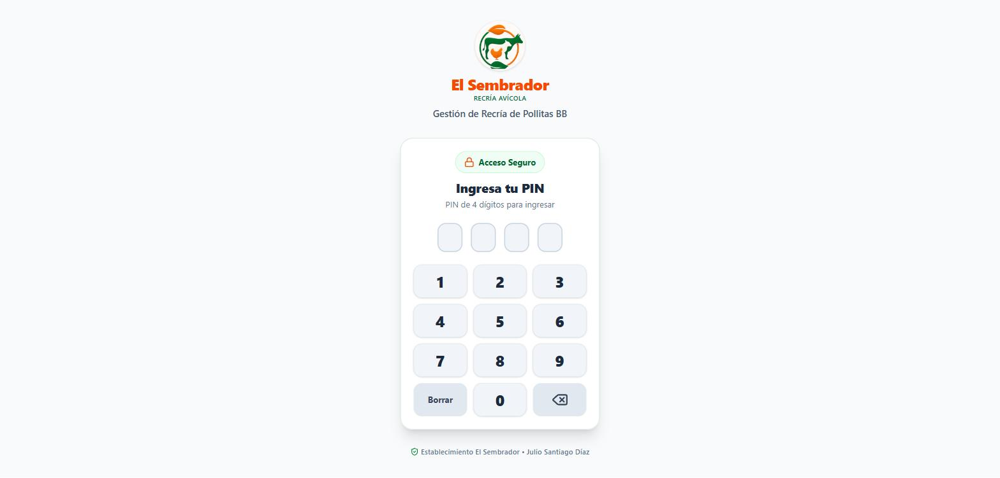
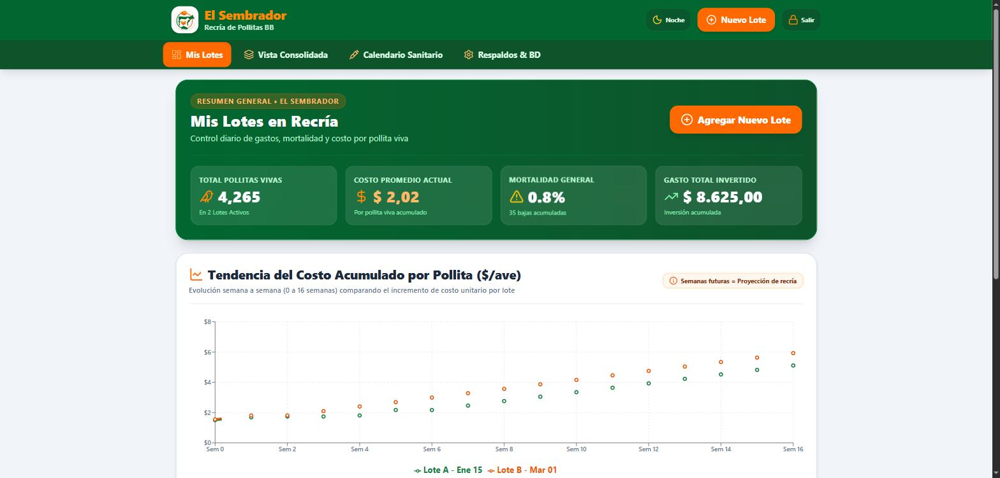
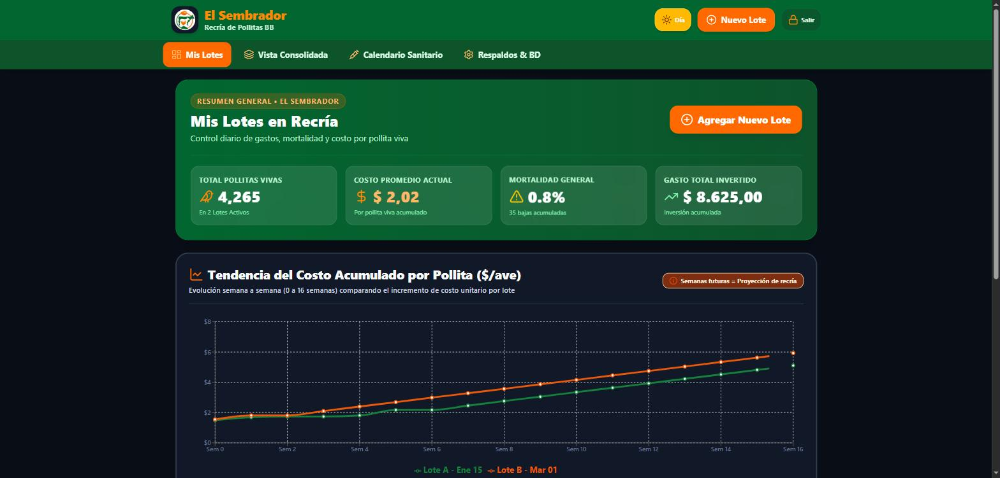
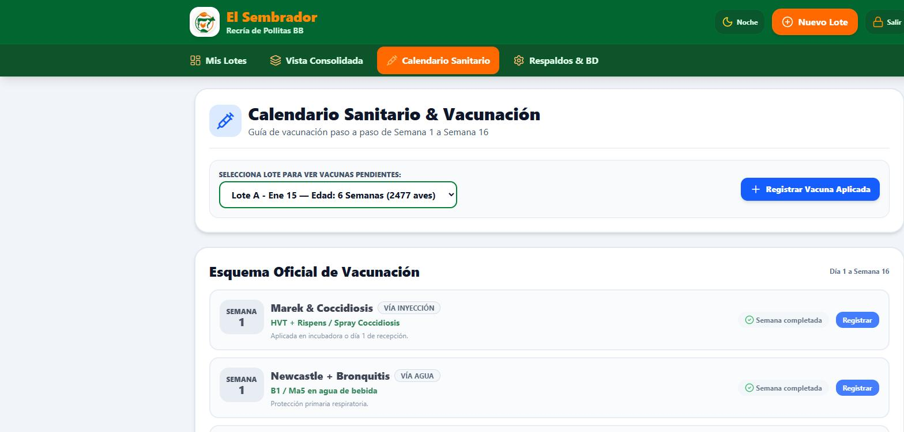

<div align="center">
  

  # SembraBB
  ### El Sembrador — Control de Recría Avícola

  Gestión y control de costos para recría de pollitas BB, de Día 0 a Semana 16.

  <p>
    
    
    
    
    
  </p>
</div>

---

## Sobre el proyecto

**SembraBB** es la aplicación interna de **El Sembrador** para llevar el control diario de la recría de pollitas BB: costos por lote, mortalidad, alimentación, calefacción, vacunación y proyección de costo por ave hasta la semana 16. Funciona 100% en el navegador (sin backend), guarda los datos en el dispositivo y se puede instalar como app en el celular.

## Características

- **Gestión de lotes** — alta de lotes con raza, cantidad inicial y costo por pollita, con seguimiento de edad en días/semanas.
- **Registro de operaciones** — alimento, mortalidad, vacunas, calefacción y otros gastos, cada uno con costo y cantidad.
- **Costos calculados en tiempo real** — costo unitario actual por ave viva, gasto total invertido y proyección de costo a semana 16.
- **Alerta de mortalidad crítica** — aviso automático cuando la mortalidad acumulada supera el 2%.
- **Calendario sanitario** — esquema oficial de vacunación (semana 1 a 16) cruzado con la edad real de cada lote.
- **Vista consolidada** — totales de toda la granja: aves vivas, inversión acumulada y mortalidad promedio.
- **Modo Noche** y **Modo Accesible** (texto grande y alto contraste, pensado para uso en galpón bajo sol).
- **Respaldo y restauración** — exportación/importación de todos los datos en un archivo JSON.
- **Acceso con PIN** de 4 dígitos.
- **Instalable (PWA)** — se agrega a la pantalla de inicio en Android y abre en pantalla completa, con soporte offline básico.

## Capturas

<table>
  <tr>
    <td align="center" width="50%">
      <br />
      <sub>Acceso con PIN</sub>
    </td>
    <td align="center" width="50%">
      <br />
      <sub>Mis Lotes — Modo Día</sub>
    </td>
  </tr>
  <tr>
    <td align="center" width="50%">
      <br />
      <sub>Mis Lotes — Modo Noche</sub>
    </td>
    <td align="center" width="50%">
      <br />
      <sub>Calendario Sanitario</sub>
    </td>
  </tr>
</table>

## Stack técnico

| | |
|---|---|
| **Framework** | React 19 + TypeScript |
| **Build** | Vite 6 |
| **Estilos** | Tailwind CSS 4 (CSS-first, sin `tailwind.config.js`) |
| **Gráficos** | Recharts |
| **Íconos** | lucide-react |
| **Animación** | motion |
| **Persistencia** | `localStorage` del navegador (sin backend) |

## Desarrollo local

**Requisitos:** Node.js

```bash
# Instalar dependencias
npm install

# Servidor de desarrollo (http://localhost:3000)
npm run dev

# Build de producción
npm run build

# Previsualizar el build
npm run preview

# Chequeo de tipos (no hay suite de tests configurada)
npm run lint
```

## Estructura del proyecto

```
src/
├── components/     # Vistas y modales de la UI
├── utils/          # Cálculos de costos/mortalidad y datos de ejemplo
├── types.ts        # Modelo de datos (Batch, OperationRecord, ...)
└── App.tsx         # Estado global, persistencia y enrutado de vistas
public/
├── icons/          # Íconos de la PWA generados a partir del logo
├── manifest.webmanifest
└── sw.js           # Service worker (instalabilidad + caché offline)
```

Todo el estado (lotes, registros, PIN, tema, accesibilidad) vive en `App.tsx` y se persiste en `localStorage`; las métricas de cada lote (mortalidad, costo por ave, proyección a semana 16) se recalculan a partir de esos datos en `src/utils/calculations.ts`.

## Despliegue

El proyecto está preparado para desplegarse en un subdirectorio (por ejemplo `https://tudominio.com/sembrador/`):

- `vite.config.ts` fija `base: '/sembrador/'` solo durante `npm run build`.
- `public/.htaccess` (se copia a `dist/`) configura compresión, cache de assets con hash, MIME del manifest y que `index.html`/`sw.js` nunca queden cacheados.

Para publicar, subir el contenido de `dist/` (generado con `npm run build`) a la carpeta correspondiente del servidor.

---

<div align="center">
  <sub>SembraBB · El Sembrador — Recría Avícola</sub>
</div>
